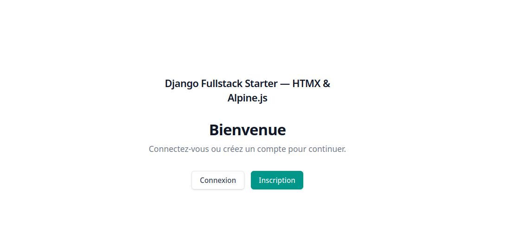
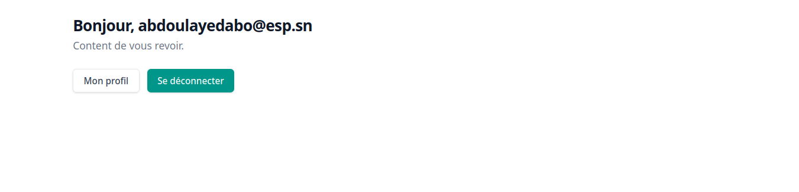
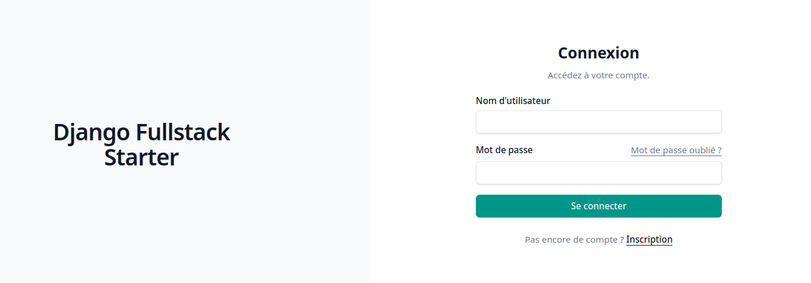
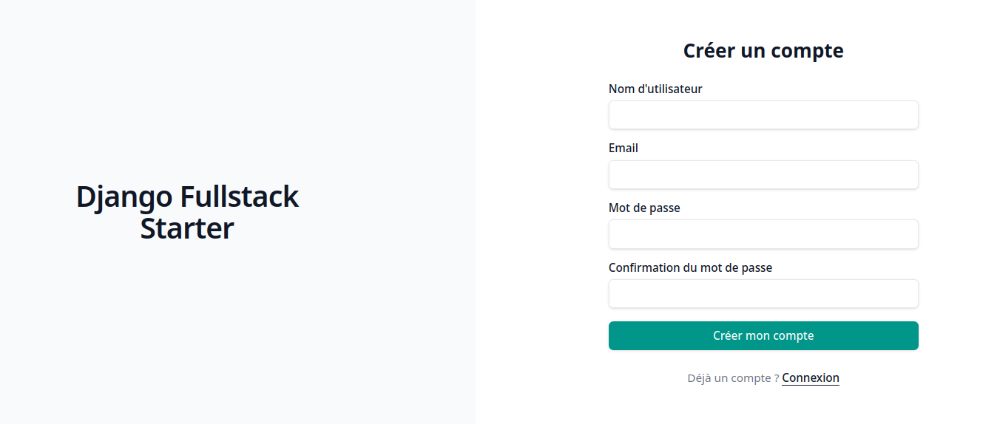
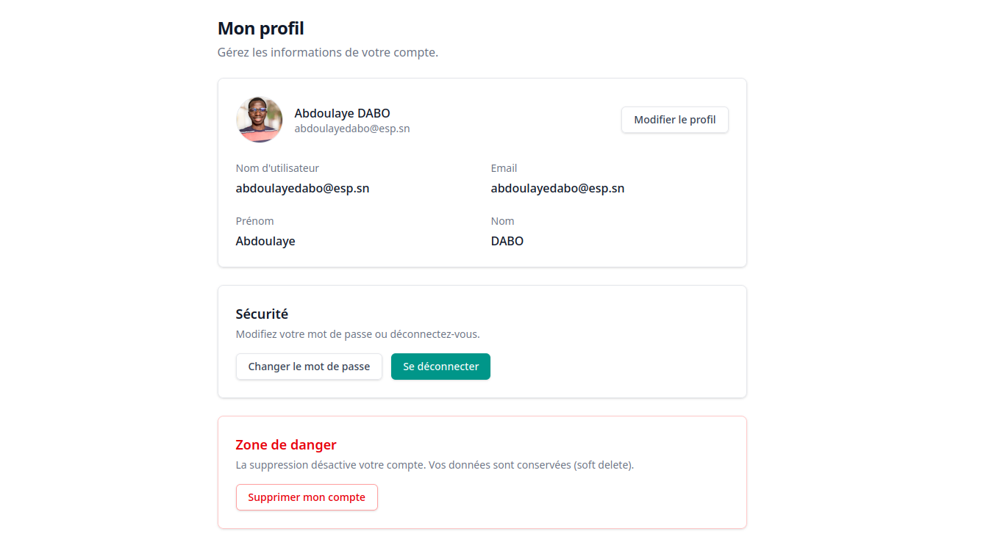
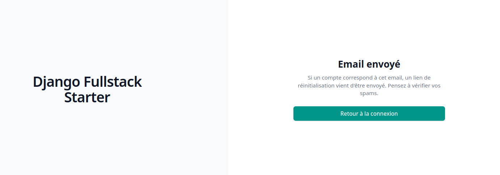

# Django Fullstack Template

Template de démarrage fullstack avec Django : authentification complète, profil avec photo, emails en arrière-plan via Celery, PostgreSQL, Redis, Nginx et Docker Compose. Le frontend reste léger grâce à Alpine.js, HTMX et Tailwind CSS.

## Stack et fonctionnalités

- 🐍 [**Django**](https://www.djangoproject.com) pour le backend et le rendu des templates.
  - 🔐 Authentification par session : inscription, connexion, déconnexion.
  - 📫 Réinitialisation et changement de mot de passe par email.
  - 👤 Profil : édition des informations et photo de profil.
  - 🗑️ Suppression douce du compte (soft delete, données conservées).
- 🎨 Frontend léger et sans build :
  - ⚡ [**Alpine.js**](https://alpinejs.dev) pour les interactions locales.
  - 🔄 [**HTMX**](https://htmx.org) pour les requêtes partielles.
  - 💅 [**Tailwind CSS**](https://tailwindcss.com) via CDN pour le style.
- 💾 [**PostgreSQL**](https://www.postgresql.org) en production, SQLite en local.
- ⚡ [**Celery**](https://docs.celeryq.dev) + [**Redis**](https://redis.io) pour les tâches en arrière-plan (envoi d'emails).
- ☁️ [**Amazon S3**](https://aws.amazon.com/s3) (ou stockage local) pour les images de profil via `django-storages` et `boto3`.
- 🐋 [**Docker Compose**](https://www.docker.com) pour lancer toute la stack :
  - 🌐 [**Nginx**](https://nginx.org) comme reverse proxy (statique et médias).
  - 🦄 [**Gunicorn**](https://gunicorn.org) pour servir Django.
  - 🗄️ PostgreSQL et Redis.
  - 👷 Worker Celery.
- 🖼️ [**WhiteNoise**](https://whitenoise.evans.io) pour servir les fichiers statiques.
- ⚙️ Configuration par variables d'environnement (`.env`).
- ✅ Tests avec le runner Django.

## Aperçu

### Landing



### Accueil connecté



### Connexion



### Inscription



### Profil



### Réinitialisation du mot de passe



## Utilisation

1. Clonez ou utilisez ce dépôt comme template.
2. Copiez `.env.example` vers `.env` et renseignez vos valeurs.
3. Suivez le guide de [développement](./development.md) pour lancer le projet en local.
4. Suivez le guide de [déploiement](./deployment.md) pour la mise en production avec Docker Compose.

## Développement

Installation locale, configuration, Celery, tests et Docker Compose : [development.md](./development.md).

## Déploiement

Déploiement avec Nginx, Gunicorn, PostgreSQL, Redis et S3 : [deployment.md](./deployment.md).

## Structure du projet

```text
.
├── accounts/                 # Application auth + profil
│   ├── migrations/
│   ├── templates/accounts/
│   ├── forms.py
│   ├── models.py
│   ├── tasks.py              # Tâche Celery d'envoi d'email
│   ├── tests.py
│   ├── urls.py
│   └── views.py
├── config/                   # Projet Django
│   ├── celery.py             # Application Celery
│   ├── settings.py
│   ├── urls.py
│   └── wsgi.py
├── nginx/
│   └── default.conf          # Reverse proxy + statique/médias
├── screenshots/              # Captures pour la documentation
├── templates/                # base.html, home.html
├── compose.yml
├── Dockerfile
├── manage.py
└── requirements.txt
```

## Tests

```bash
python manage.py test
```

Ou via Docker :

```bash
docker compose run --rm web python manage.py test
```
